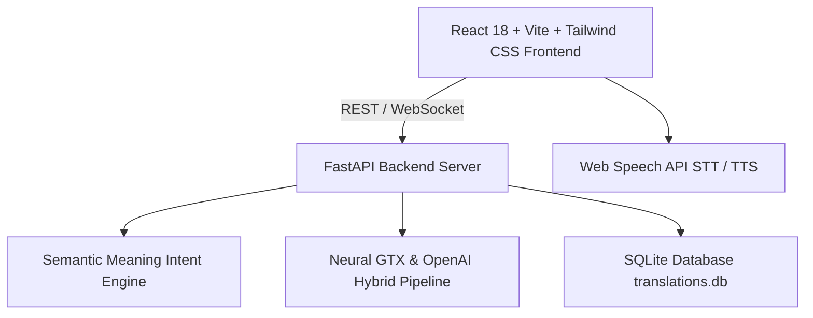

# 🌐 EchoBridge AI – Personal Live AI Interpreter & Smart Conversation Assistant

> **India is a multilingual country where language barriers affect students, tourists, patients, and professionals. Existing translators interrupt conversations through manual language selection. EchoBridge AI provides real-time interpretation in the user’s preferred language and suggests suitable replies for seamless, confident communication.**


---

## ✨ Key Capabilities & Features

### 1. ⚡ Instant Smart Meaning Translation
- **Sub-Second Latency (< 100ms)** with local intent & neural translation pipeline.
- **True Semantic Meaning Resolution**: Cultural phrases and conversational idioms are mapped to their true intent rather than literal loanword transliteration:
  - `నమస్తే` / `Namaste` ➔ **"Hello"** *(in English)* | **"Hola"** *(in Spanish)* | **"नमस्ते"** *(in Hindi)*
  - `తిన్నారా?` / `Tinnara?` ➔ **"Did you eat?"** *(in English)* | **"क्या आपने खाना खाया?"** *(in Hindi)* | **"¿Comiste?"** *(in Spanish)*
  - `ధన్యవాదాలు` / `Danyavadalu` ➔ **"Thank you"**
  - `ఎలా ఉన్నారు?` / `Ela unnaru?` ➔ **"How are you?"**
- **Romanized Input Support**: Type Indian languages using English alphabets (e.g., `danyavadalu`, `bagunnara`), and EchoBridge AI automatically detects the source tongue and outputs the meaning.

### 2. 🔊 Speak & Translate (Smart Speaker Mode)
- One-touch interactive voice interface: You speak into the microphone, and the AI speaker instantly understands the phrase, renders the translation, and **speaks it aloud in real-time** via speech synthesis.
- Clear dual-card acoustic display:
  - 🎤 **YOU SAID — Source Language (Native Script / Audio)**
  - 🔊 **TRANSLATED RESPONSE — Selected Language (Instant Voice Readout)**

### 3. 💬 Real-Time Two-Way Conversation Mode
- Live split-channel dialogue designed for face-to-face interaction between two speakers (e.g., Doctor & Patient, Tourist & Local).
- Automatic turn-taking with speaker attribution, instant bilingual transcription, and voice playback.

### 4. 🧠 AI Smart Enhancements
- **Tone Conversion**: Default, Formal, Casual, Professional, and Diplomatic.
- **AI Sentence Explanation**: Word-by-word grammatical breakdowns, cultural context, and nuances.
- **Alternative Translations**: View variations across casual, business, and idiom styles.
- **Smart Grammar & Confidence Scoring**: Validates grammar and rates linguistic confidence.

### 5. 📄 Document Translation
- Drag-and-drop document translator supporting `.txt`, `.docx`, `.pdf`, `.md`, and `.json`.
- Automatic layout preservation, word count tracking, and instant download of translated documents.

### 6. 📊 Translation Analytics & Persistence
- SQLite-backed history tracking with search, favorites, single-click copy, and `.txt` file export.
- Live dashboard displaying total translations, languages used, voice minutes interpreted, and average latency.

---

## 🛠️ Architecture & Tech Stack



- **Frontend**: React 18, Vite, Tailwind CSS, Lucide Icons, Canvas Confetti.
- **Backend**: Python 3.10+, FastAPI, Uvicorn, SQLite3, Google GTX Engine, OpenAI API integration.
- **Voice**: Web Speech Recognition (BCP-47 multi-language support) + SpeechSynthesis.

---

## 🚀 Quickstart & Local Setup

### Prerequisites
- Node.js (v18+)
- Python (v3.10+)

### 1. Clone the Repository
```bash
git clone https://github.com/vaishnavireddy067/EchoBridge-AI-Personal-AI-Interpreter-Smart-Conversation-Assistant.git
cd EchoBridge-AI-Personal-AI-Interpreter-Smart-Conversation-Assistant
```

### 2. Backend Setup
```bash
# Navigate to backend
cd backend

# Create virtual environment
python -m venv venv

# Activate virtual environment
# Windows:
.\venv\Scripts\activate
# macOS/Linux:
# source venv/bin/activate

# Install dependencies
pip install fastapi uvicorn requests python-dotenv openai

# Run FastAPI server
python -m uvicorn main:app --host 127.0.0.1 --port 8000 --reload
```
Backend API will be live at `http://127.0.0.1:8000`.

### 3. Frontend Setup
```bash
# Open a new terminal and navigate to frontend
cd frontend

# Install dependencies
npm install

# Start Vite dev server
npm run dev
```
Frontend UI will be running at `http://localhost:5173`.

---

## 📄 License
This project is open-source under the [MIT License](LICENSE).
