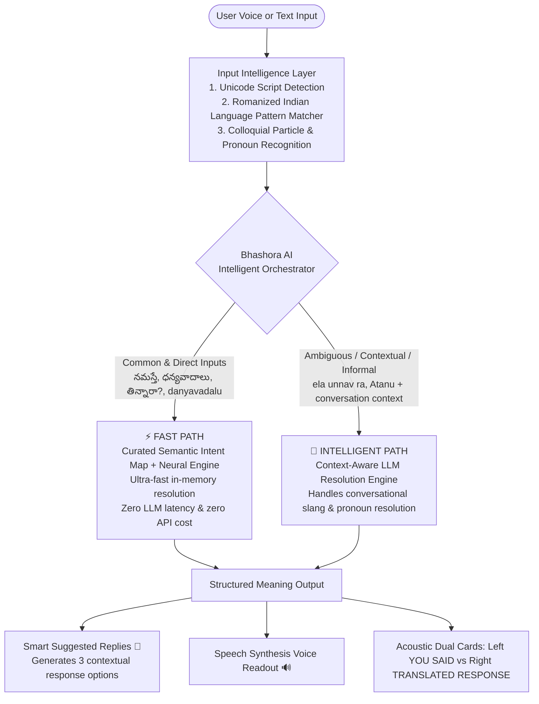

# 🌐 Bhashora AI – Personal Live AI Interpreter & Smart Conversation Assistant

> **India is a multilingual country where language barriers affect students, tourists, patients, and professionals. Existing translators interrupt conversations through manual language selection. Bhashora AI provides real-time interpretation in the user’s preferred language and suggests suitable replies for seamless, confident communication.**


---

## 🏛️ Architecture: Bhashora AI Intelligent Orchestrator

Bhashora AI implements a **Low-Latency Hybrid AI Architecture**. Instead of routing every single input through costly LLM APIs, a central orchestrator intelligently classifies each request:



---

## ✨ Key Capabilities & Features

### 1. 💬 Smart Suggested Replies (Headline Pitch)
- When a phrase or question is translated, Bhashora AI automatically suggests **3 context-aware, natural replies** in the listener's language.
- **Example**:
  - Incoming translated phrase: *"Did you eat?"* (తిన్నారా?)
  - **Suggested Replies**:
    - `[Affirmative]`: *"Yes, I just had my meal. Did you eat?"*
    - `[Casual]`: *"Not yet, I will eat in a little while."*
    - `[Polite]`: *"Yes, finished! Thank you for asking."*
- Available with 1-click auto-fill in **Two-Way Conversation Mode** and 1-click voice readout in **Speak & Translate Mode**.

### 2. ⚡ Low-Latency Hybrid Pipeline (Fast Path vs. Intelligent Path)
- **Fast Path ⚡**:
  - Powered by a curated semantic intent dictionary + in-memory cache covering high-frequency conversational phrases, greetings, and expressions.
  - On a match, resolution occurs in-memory (~10-40ms response), bypassing LLMs completely.
  - On a miss, requests route smoothly through the neural translation engine.
- **Intelligent Path 🧠**:
  - Invoked strictly when inputs contain informal slang (`ra`, `bhai`), ambiguous words, contextual pronouns, or when specific tones are requested.
  - `ela unnav ra` ➔ Recognizes informal Telugu particle `ra` ➔ **"How are you, bro?"**
  - Conversation reference: Turn 1 *"Ravi will come tomorrow."* ➔ Turn 2 *"Atanu eppudu vastadu?"* ➔ **"When will he (Ravi) come?"**

### 3. 🎯 Meaning-Based Translation (NOT Transliteration)
- Never confuses script conversion with meaning:
  - Input: `నమస్తే` (Telugu) ➔ Target: English ➔ Output: **`"Hello"`** *(Never "Namaste")*
  - Input: `తిన్నారా?` (Telugu) ➔ Target: English ➔ Output: **`"Did you eat?"`** *(Never "Tinnara?")*
  - Input: `నమస్తే` (Telugu) ➔ Target: Spanish ➔ Output: **`"Hola"`**
  - Input: `నమస్తే` (Telugu) ➔ Target: Hindi ➔ Output: **`"नमस्ते"`**

### 4. 🇮🇳 Romanized Indian-Language Input Support
- Type Indian languages naturally using English letters:
  - `danyavadalu` ➔ maps meaning ➔ **"Thank you"**
  - `ela unnaru` ➔ maps meaning ➔ **"How are you?"**
  - `bhojanam chesara` ➔ maps meaning ➔ **"Did you have food?"**

### 5. 🔊 Speak & Translate (Smart Speaker Mode)
- **Voice In ➔ Voice Out**: Speak into the microphone in any supported language; the device translates the meaning and **speaks it aloud in real-time** via browser speech synthesis.
- **Acoustic Dual-Card Interface**:
  - 🎤 **YOU SAID — Source Language** (e.g. `Telugu (తెలుగు)`)
  - 🔊 **TRANSLATED RESPONSE — Target Language** (e.g. `English`)

### 6. 🗣️ Real-Time Two-Way Conversation Mode
- Live split-channel interface for dialogue between two people speaking different languages (e.g., Doctor & Patient).
- Automatic turn-taking with speaker attribution, instant bilingual transcription, and conversational context persistence.

### 7. 🧠 AI Linguistic Enhancements
- **Tone Conversion**: Default, Formal, Casual, Professional, Friendly, or Concise.
- **Alternative Phrasings**: View 3 variations tailored for business, casual chat, or expressive social settings.
- **AI Sentence Explanation**: Word-by-word grammatical breakdown, formality rating, and pronunciation guidance.
- **Grammar Polish**: Automatically fixes punctuation, capitalization, and sentence boundaries.

### 8. 📄 Document Translation & SQLite Analytics
- Upload `.txt`, `.docx`, `.pdf`, and `.md` files for instant paragraph-by-paragraph translation and `.txt` export.
- SQLite-backed history tracking (`translations.db`) with search, favorites bookmarking, and live latency metrics.

---

## 🔍 How Auto-Detection Works

Bhashora AI eliminates manual language switching using a 3-tier detection pipeline:
1. **Tier 1 (Unicode Script Analysis)**: Inspects character codepoints to instantly classify native Indic scripts (Telugu `0x0C00–0x0C7F`, Devanagari `0x0900–0x097F`, Tamil, Kannada, Malayalam, Bengali, Gujarati).
2. **Tier 2 (Romanized Indian Pattern Matcher)**: Analyzes Latin-typed words against a corpus of common Telugu/Hindi grammatical markers (e.g. `unnav`, `chesara`, `tinnava`, `ra`, `kya`, `hai`, `bhai`) to infer the underlying Indian tongue.
3. **Tier 3 (Statistical N-gram Fallback)**: Uses `langdetect` for standard Latin-script global languages (English, Spanish, French, German, etc.).

---

## 🛠️ Tech Stack & Modular Organization

```
backend/
├── main.py                     # FastAPI server, REST & WebSocket endpoints, SQLite schema
├── services/
│   ├── orchestrator.py         # Central decision engine (Fast Path vs. Intelligent Path)
│   ├── reply_service.py        # Smart Suggested Replies generator
│   ├── language_service.py     # 3-tier script & Romanized language detection
│   ├── translation_service.py  # Curated semantic intent dictionary & neural translation
│   ├── llm_service.py          # OpenAI GPT integration with automatic graceful fallback
│   └── context_service.py      # Conversation turn window & entity pronoun manager
├── .env.example                # Sample environment template
├── requirements.txt
frontend/
├── src/
│   ├── App.jsx                 # Glassmorphism UI, Speech STT/TTS, Smart Replies
│   ├── index.css               # Tailwind CSS & design tokens
│   └── main.jsx
├── package.json
└── vite.config.js
```

---

## 🚀 Quickstart & Local Setup

### 1. Clone the Repository
```bash
git clone https://github.com/vaishnavireddy067/EchoBridge-AI-Personal-AI-Interpreter-Smart-Conversation-Assistant.git "Bhashora AI – Personal Live AI Interpreter"
cd "Bhashora AI – Personal Live AI Interpreter"
```

### 2. Backend Setup
```bash
cd backend
python -m venv venv

# Windows:
.\venv\Scripts\activate
# macOS/Linux:
# source venv/bin/activate

pip install -r requirements.txt

# Configure environment (Optional for LLM features)
cp .env.example .env

# Start FastAPI server
python -m uvicorn main:app --host 127.0.0.1 --port 8000 --reload
```
> **Note on OpenAI Key**: An OpenAI API key in `.env` is optional for advanced LLM features. If omitted or out of credits, Bhashora AI automatically falls back to its built-in Semantic Intent Engine and Neural Translation without interruption.

Backend API will be live at `http://127.0.0.1:8000`.

### 3. Frontend Setup
```bash
cd frontend
npm install
npm run dev
```
Frontend UI will be running at `http://localhost:5173`.

---

## ⚠️ Known Limitations
- **Speech Recognition Support**: Web Speech API (`webkitSpeechRecognition`) is natively supported on Chromium-based browsers (Google Chrome, Microsoft Edge, Brave). Safari/Firefox have limited support for Indian language speech recognition.
- **Lightweight Neural Translation**: The secondary neural translation engine is designed for development and low-to-medium traffic. For enterprise high-volume deployments, plug in dedicated cloud translation endpoints.

---

## 📄 License
This project is open-source under the [MIT License](LICENSE).

