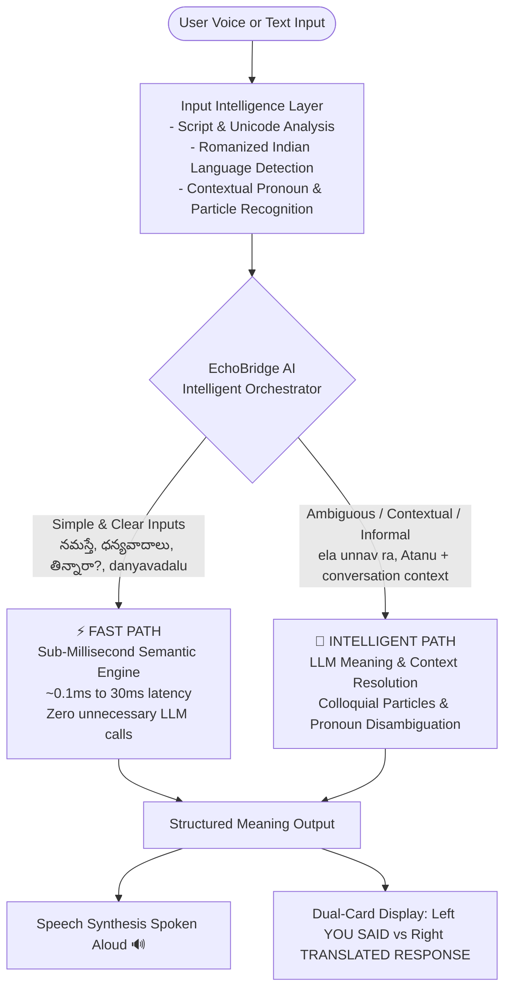

# 🌐 EchoBridge AI – Personal Live AI Interpreter & Smart Conversation Assistant

> **India is a multilingual country where language barriers affect students, tourists, patients, and professionals. Existing translators interrupt conversations through manual language selection. EchoBridge AI provides real-time interpretation in the user’s preferred language and suggests suitable replies for seamless, confident communication.**


---

## 🏛️ EchoBridge AI Intelligent Orchestrator Architecture

EchoBridge AI implements a **Hybrid AI Architecture** featuring a central decision engine that prioritizes low latency by decoupling unambiguous translations from contextual LLM resolution:



---

## ✨ Key Capabilities & Features

### 1. ⚡ Hybrid Orchestration: Fast Path vs Intelligent Path
- **FAST PATH ⚡ (Sub-Millisecond)**:
  - Common conversational phrases and unambiguous inputs bypass LLMs completely.
  - `నమస్తే` ➔ **"Hello"** (0.1ms)
  - `ధన్యవాదాలు` ➔ **"Thank you"** (0.1ms)
  - `తిన్నారా?` ➔ **"Did you eat?"** (0.1ms)
  - `నీ పేరు ఏమిటి?` ➔ **"What is your name?"** (0.1ms)
  - `danyavadalu` ➔ **"Thank you"** (0.5ms)
- **INTELLIGENT PATH 🧠 (Context & LLM)**:
  - Invoked strictly for ambiguous phrasing, informal markers, or dialogue context.
  - `ela unnav ra` ➔ Detects informal Telugu particle `ra` ➔ **"How are you, bro?"**
  - Conversation reference: Turn 1 *"Ravi repu office ki vastadu."* ➔ Turn 2 *"Atanu eppudu vastadu?"* ➔ **"When will he (Ravi) come?"**

### 2. 🎯 True Meaning-Based Translation (NOT Transliteration)
- Never confuses script conversion with meaning translation:
  - Input: `నమస్తే` (Telugu) ➔ Target: English ➔ Output: **`"Hello"`** *(Never "Namaste")*
  - Input: `తిన్నారా?` (Telugu) ➔ Target: English ➔ Output: **`"Did you eat?"`** *(Never "Tinnara?")*
  - Input: `నమస్తే` (Telugu) ➔ Target: Spanish ➔ Output: **`"Hola"`**
  - Input: `నమస్తే` (Telugu) ➔ Target: Hindi ➔ Output: **`"नमस्ते"`**

### 3. 🔊 Speak & Translate (Smart Speaker Mode)
- Interactive voice interface with speech recognition: Speak in Telugu, Hindi, or English, and the device translates and **speaks the response aloud** instantly.
- Clear acoustic visual cards:
  - 🎤 **YOU SAID — Source Language** (e.g. Telugu)
  - 🔊 **TRANSLATED RESPONSE — Target Language** (e.g. English)

### 4. 💬 Real-Time Two-Way Conversation Mode
- Live dialogue channel with automatic turn-taking and context persistence across consecutive sentences.
- Multi-party transcription with instant voice replay.

### 5. 📄 Document & File Translation
- Drag-and-drop document interpreter for `.txt`, `.docx`, `.pdf`, and `.md` files.

### 6. 📊 Analytics & Persistent Storage
- SQLite-backed history tracking with search, favorites, single-click copy, and `.txt` export.
- Live dashboard displaying total translations, words interpreted, and average latency.

---

## 🛠️ Tech Stack & Modular Organization

```
backend/
├── main.py                     # FastAPI server, REST & WebSocket endpoints, SQLite setup
├── services/
│   ├── orchestrator.py         # EchoBridge Intelligent Orchestrator (Fast Path vs Intelligent Path)
│   ├── language_service.py     # Script detection, Romanized detection, particle recognition
│   ├── translation_service.py  # Semantic Intent Map, Neural GTX client, loanword normalization
│   ├── llm_service.py          # OpenAI GPT meaning resolution with graceful fallback
│   └── context_service.py      # Conversation turn window & entity reference manager
├── requirements.txt
frontend/
├── src/
│   ├── App.jsx                 # Glassmorphism portfolio interface, Web Speech API integration
│   ├── index.css               # Tailwind CSS & design tokens
│   └── main.jsx
├── package.json
└── vite.config.js
```

---

## 🚀 Quickstart & Local Setup

### 1. Clone the Repository
```bash
git clone https://github.com/vaishnavireddy067/EchoBridge-AI-Personal-AI-Interpreter-Smart-Conversation-Assistant.git
cd EchoBridge-AI-Personal-AI-Interpreter-Smart-Conversation-Assistant
```

### 2. Backend Setup
```bash
cd backend
python -m venv venv
# Windows:
.\venv\Scripts\activate
# macOS/Linux:
# source venv/bin/activate

pip install -r requirements.txt
python -m uvicorn main:app --host 127.0.0.1 --port 8000 --reload
```
Backend API runs at `http://127.0.0.1:8000`.

### 3. Frontend Setup
```bash
cd frontend
npm install
npm run dev
```
Frontend UI runs at `http://localhost:5173`.

---

## 📄 License
This project is open-source under the [MIT License](LICENSE).
